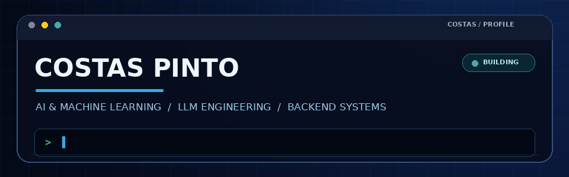

### AI & Machine Learning Developer · Generative AI · LLM Engineering · Backend Systems

**I build practical AI products — from LLM-powered applications and RAG systems to backend services and full-stack platforms.**

---

## `01 / DEVELOPER OVERVIEW`

<table>
<tr>
<td width="58%" valign="top">

### Hi, I'm Costas Pinto

I'm an AI & Machine Learning Developer with an MCA specialization in Artificial Intelligence and Machine Learning from **Manipal University Jaipur**, and a BSc in Computer Science from **Shivaji University**.

I enjoy taking ideas from prototype to working software: designing ML workflows, building LLM applications, developing APIs, integrating databases, and shipping full-stack products.

My current engineering interests include **Generative AI, RAG, LLM orchestration, AI agents, backend AI systems, and intelligent automation**.

</td>
<td width="42%" valign="top">

### Focus dashboard

| Area | Current focus |
|:--|:--|
| AI / ML | Predictive modelling, evaluation |
| GenAI | LLMs, prompting, orchestration |
| Retrieval | RAG, embeddings, vector search |
| Backend | FastAPI, REST APIs, PostgreSQL |
| Product | React, Next.js, integrations |
| Delivery | Docker, Git, cloud deployment |

</td>
</tr>
</table>

> **Engineering mindset:** Build deliberately. Validate with evidence. Improve continuously.

## `02 / TECH STACK`

### Programming languages

### Machine learning & data science

`Pandas` · `NumPy` · `XGBoost` · `Keras` · `Matplotlib` · `Seaborn` · `Jupyter`

### LLMs, Generative AI & retrieval

`RAG` · `Embeddings` · `Vector Search` · `Prompt Engineering` · `LLM Evaluation` · `AI Agents`

### Backend, frontend & databases

### Cloud, DevOps & developer tools

## `03 / FEATURED BUILDS`

<table>
<tr>
<td width="50%" valign="top">

### [CareerSaathi](https://github.com/costaspinto/CareerSaathi)

**Local-first career workspace**

A desktop-oriented career product for profile evidence management, job analysis, focused resume generation, application tracking, and a Chrome companion.

`Python` `FastAPI` `SQLite` `JavaScript` `Chrome MV3`

</td>
<td width="50%" valign="top">

### [DocuReadAI](https://github.com/costaspinto/DocuReadAI)

**Document intelligence with RAG**

An assistant that ingests PDF documents, retrieves relevant context using vector search, and generates grounded answers.

`LangChain` `ChromaDB` `Hugging Face` `IBM watsonx`

</td>
</tr>
<tr>
<td width="50%" valign="top">

### [PulmoProbe AI](https://github.com/costaspinto/Pulmo_Probe)

**Machine learning healthcare application**

A research-oriented prediction platform featuring data preparation, feature engineering, model evaluation, and a web interface.

`XGBoost` `FastAPI` `React` `Docker`

</td>
<td width="50%" valign="top">

### [AmbedkarGPT](https://github.com/costaspinto/AmbedkarGPT)

**Local document-grounded Q&A**

An offline RAG workflow that embeds source material, retrieves relevant passages, and answers questions using a local language model.

`LangChain` `Ollama` `ChromaDB` `Sentence Transformers`

</td>
</tr>
<tr>
<td width="50%" valign="top">

### [Atomic Explorer](https://github.com/costaspinto/Atomic_Explorer)

**Interactive 3D learning experience**

An educational application combining atomic visualization, interactive chemistry concepts, and AI-assisted functionality.

`React` `Vite` `Three.js` `React Three Fiber`

</td>
<td width="50%" valign="top">

### [Nirmaan Scorer](https://github.com/costaspinto/Nirmaan-Scorer)

**Speech and communication analysis**

An AI-assisted system that evaluates spoken communication using transcript analysis and language-processing techniques.

`Python` `FastAPI` `React` `spaCy` `NLP`

</td>
</tr>
<tr>
<td width="50%" valign="top">

### [ImageCap](https://github.com/costaspinto/IMageCap)

**Vision-language image captioning**

An image captioning application using BLIP with caption styles, emotion tags, and multilingual support.

`PyTorch` `BLIP` `Hugging Face` `Gradio`

</td>
<td width="50%" valign="top">

### [SmartTask AI](https://github.com/costaspinto/SmartTask-AI---Full-Stack-Task-Management-Platform)

**Full-stack task management**

A task management platform with authentication, CRUD workflows, dashboard analytics, and REST API architecture.

`Next.js` `React` `Node.js` `Express` `MongoDB`

</td>
</tr>
</table>

## `04 / GITHUB ANALYTICS`

 

 

<h3>Contribution Activity</h3>

  

The animated contribution graph is generated daily by GitHub Actions.

## `05 / EDUCATION & LEARNING`

| Qualification | Institution |
|:--|:--|
| MCA — Artificial Intelligence & Machine Learning (2024–2026) | Manipal University Jaipur |
| BSc — Computer Science (2016–2019) | Shivaji University, Kolhapur |

**Selected certifications:** IBM AI Engineering · IBM Generative AI Engineering · Generative AI with Large Language Models · Google AI Essentials · Oracle Cloud Infrastructure AI Foundations · Intel AI Fundamentals · Reinforcement Learning — University of Alberta.

## `06 / CONNECT`

**Interested in AI engineering, open-source collaboration, and building useful software.**

*Build with purpose. Learn continuously. Ship better.*

